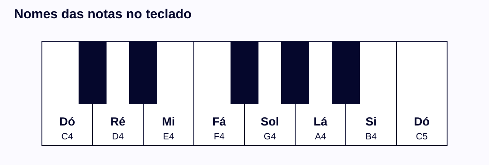
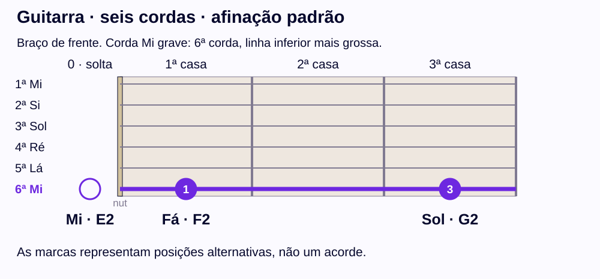
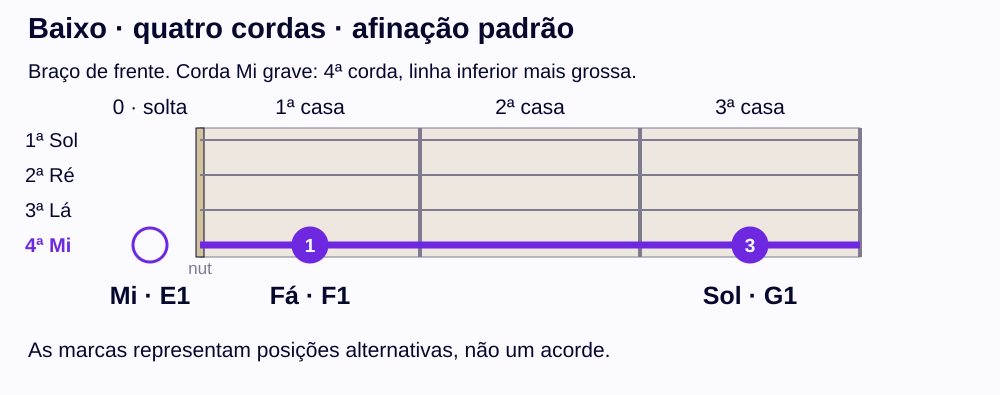

# C, D, E…: o código que todo músico usa

## Para que você vai usar isso?

Você quer tocar com outras pessoas e aprender suas músicas com cifras e tutoriais, sem travar. Para isso, precisa entender o código que todo músico usa. Num ensaio, alguém diz **“a música está em G”**: saber que G é Sol permite acompanhar a conversa. Em cifras e tutoriais, as notas aparecem como **C, D, E**, mesmo quando você aprendeu **Dó, Ré, Mi**. Com o código, uma indicação como **E–F–G** e outra como **Mi–Fá–Sol** passam a dizer a mesma coisa.

Esses nomes vão reaparecer em melodias, escalas e cifras. Numa cifra, **C** indica o acorde de Dó maior; o nome da nota ajuda a entender o nome do acorde, mas tocar uma nota Dó e tocar o acorde de Dó maior são ações diferentes. Vamos estudar a formação dos acordes em outro momento.

**Ao terminar esta lição, você poderá relacionar os nomes às letras e localizar exemplos com uma referência, sem precisar reconhecer notas de ouvido ou decorar o braço inteiro.** Os exemplos usam teclado, guitarra e baixo. Você pode fazer todas as atividades sem ter um instrumento.

## Um mesmo nome pode aparecer de duas formas

Em português, usamos os nomes **Dó, Ré, Mi, Fá, Sol, Lá e Si**. Em muitos materiais, essas mesmas notas aparecem como letras:

| Nome | Dó | Ré | Mi | Fá | Sol | Lá | Si |
|---|---|---|---|---|---|---|---|
| Letra | C | D | E | F | G | A | B |

Para consultar a tabela, escolha o nome na primeira linha e leia a letra abaixo. Fá corresponde a **F**. No sentido contrário, **A** corresponde a Lá. A letra A não corresponde a Dó: cada letra tem seu próprio par.

Vamos conferir juntos: **Mi–Fá–Sol** corresponde a **E–F–G**. A sequência mantém as mesmas notas; mudamos apenas a maneira de escrever seus nomes.

### Sua vez: uma indicação escrita

Use a tabela para responder. O objetivo é aprender a consultar a referência; a memorização pode vir com a prática.

<!-- activity: a-name-f -->
<fieldset class="practice" data-activity="a-name-f"><legend>Qual letra representa Fá?</legend><label class="choice"><input type="radio" name="a-name-f" value="a"/>E</label><label class="choice"><input type="radio" name="a-name-f" value="b"/>F</label><label class="choice"><input type="radio" name="a-name-f" value="c"/>G</label>

Uma dica

Localize Fá na primeira linha da tabela e leia a letra logo abaixo.

Conferir resposta

<strong>Resposta: F.</strong> Fá corresponde a F. As duas formas indicam o mesmo nome de nota.
<ul><li><strong>Se você escolheu “E”:</strong> E representa Mi. Procure Fá na linha dos nomes.</li><li><strong>Se você escolheu “G”:</strong> G representa Sol. Fá corresponde a outra letra.</li></ul><h4>Pratique de novo</h4><fieldset class="practice" data-activity="a-name-g-retry"><legend>Pratique de novo: qual letra representa Sol?</legend><label class="choice"><input type="radio" name="a-name-g-retry" value="a"/>A</label><label class="choice"><input type="radio" name="a-name-g-retry" value="b"/>F</label><label class="choice"><input type="radio" name="a-name-g-retry" value="c"/>G</label>

Uma dica

Consulte a coluna de Sol na tabela.

Conferir resposta

<strong>Resposta: G.</strong> Sol corresponde a G. A consulta funciona nos dois sentidos, nome para letra e letra para nome.
<ul><li><strong>Se você escolheu “A”:</strong> A corresponde a Lá.</li><li><strong>Se você escolheu “F”:</strong> F corresponde a Fá.</li></ul>

</fieldset>

</fieldset>
<!-- /activity -->

## As notas na pauta

Na partitura, os mesmos nomes aparecem na **pauta**, com cinco linhas. Com a **clave de sol**, o Dó central (C4) fica numa linha extra abaixo da pauta. A partir dele, cada nota seguinte sobe um degrau, alternando linha e espaço: Ré abaixo da primeira linha, Mi na primeira linha, Fá no primeiro espaço, Sol na segunda linha, Lá no segundo espaço e Si na terceira linha. Ler partitura não é necessário nesta lição; a pauta mostra que é o mesmo código em outra escrita.

## O código também nas mãos

O mesmo código aparece fora do papel. No palco, músicos costumam combinar o tom da música com sinais de mão, com a palma voltada para a banda: um dedo levantado para Dó, dois para Ré, três para Mi, quatro para Fá, a mão aberta para Sol, polegar e mínimo para Lá e só o mínimo para Si. Em geral, a mão para cima indica maior e a mão virada para baixo indica menor; maior e menor são assunto de outra lição. As convenções variam entre grupos, então combine os sinais antes de tocar.

## Encontrando os nomes no teclado

As teclas pretas formam grupos de duas e de três. A tecla branca **imediatamente à esquerda do grupo de duas teclas pretas** é um Dó. A partir dela, os nomes das teclas brancas seguem Dó, Ré, Mi, Fá, Sol, Lá e Si. As teclas pretas também representam notas; vamos usar seus nomes na próxima lição, quando contarmos distâncias.

**Leitura em texto:** C4–D4–E4–F4–G4–A4–B4–C5 são as teclas brancas mostradas, da esquerda para a direita. Há duas teclas pretas entre C4 e E4 e três entre F4 e B4.

Encontre **F4** no desenho. Consulte a tabela: F é Fá. Procure a tecla branca com esse rótulo. Agora encontre **G4** da mesma maneira: G é Sol. Você já transformou uma indicação escrita em uma posição visível.

## O nome se repete; a altura muda

Depois do Si, os nomes recomeçam em Dó. Essa repetição acontece numa outra **oitava**. No desenho, **C4** e **C5** são dois Dós: C5 está uma oitava acima de C4, numa região mais aguda.

Usaremos o número junto à letra para diferenciar as oitavas. Ele **não indica casa, corda nem dedo**. Quando o rótulo é F4, o 4 identifica a oitava do Fá neste sistema de referência. O nome Dó, sozinho, não determina em qual oitava a nota está.

Você pode comparar os rótulos mesmo sem ouvir as notas. Por enquanto, queremos distinguir **o nome da nota** de **sua altura em uma oitava específica**.

<!-- activity: a-octaves -->
<fieldset class="practice" data-activity="a-octaves"><legend>O que C4 e C5 têm em comum e o que muda?</legend><label class="choice"><input type="radio" name="a-octaves" value="a"/>Mesmo nome, mas alturas em oitavas diferentes</label><label class="choice"><input type="radio" name="a-octaves" value="b"/>Nomes diferentes e a mesma altura</label><label class="choice"><input type="radio" name="a-octaves" value="c"/>Mesmo nome e exatamente a mesma altura</label>

Uma dica

Separe a informação da letra da informação do número.

Conferir resposta

<strong>Resposta: Mesmo nome, mas alturas em oitavas diferentes.</strong> Os dois são Dó. C5 fica uma oitava acima de C4; o número identifica a oitava da referência.
<ul><li><strong>Se você escolheu “Nomes diferentes e a mesma altura”:</strong> As duas letras são C, que representa Dó.</li><li><strong>Se você escolheu “Mesmo nome e exatamente a mesma altura”:</strong> Os números 4 e 5 indicam oitavas diferentes.</li></ul><h4>Pratique de novo</h4><fieldset class="practice" data-activity="a-octaves-retry"><legend>Pratique de novo: E1 e E2 têm o mesmo nome? Qual é mais aguda?</legend><label class="choice"><input type="radio" name="a-octaves-retry" value="a"/>Mesmo nome, e E1 é mais aguda</label><label class="choice"><input type="radio" name="a-octaves-retry" value="b"/>Mesmo nome, e E2 é mais aguda</label><label class="choice"><input type="radio" name="a-octaves-retry" value="c"/>Nomes diferentes, e E2 é mais aguda</label>

Uma dica

Compare a letra primeiro. Depois veja qual número de oitava é maior.

Conferir resposta

<strong>Resposta: Mesmo nome, e E2 é mais aguda.</strong> As duas notas são Mi. E1 e E2 têm o mesmo nome em registros diferentes; E2 está uma oitava acima de E1.
<ul><li><strong>Se você escolheu “Mesmo nome, e E1 é mais aguda”:</strong> O número 2 indica a oitava acima da 1.</li><li><strong>Se você escolheu “Nomes diferentes, e E2 é mais aguda”:</strong> A letra E é a mesma nas duas notas.</li></ul>

</fieldset>

</fieldset>
<!-- /activity -->

## O mesmo raciocínio na guitarra e no baixo

A guitarra e o baixo usam cordas e casas. **Corda solta** significa tocar a corda sem pressionar uma casa. O **nut** é a peça junto ao começo do braço; muitos músicos o chamam de pestana, palavra que também nomeia a técnica de prender várias cordas com um dedo. Os **trastes** são as divisões de metal; a casa fica no espaço entre dois trastes, ou entre o nut e o primeiro traste.

Nos desenhos abaixo, o braço está de frente para você, com o nut à esquerda. A corda Mi mais grave está na parte inferior, destacada por uma linha mais grossa e pelo nome. As marcas mostram **posições alternativas nessa mesma corda**, e não notas que precisam soar juntas. O círculo vazio indica a corda solta.

### Guitarra: sexta corda na afinação padrão

### Baixo: quarta corda na afinação padrão

| Posição na corda destacada | Guitarra | Baixo |
|---|---|---|
| Solta, sem apertar uma casa | Mi, E2 | Mi, E1 |
| Primeira casa | Fá, F2 | Fá, F1 |
| Terceira casa | Sol, G2 | Sol, G1 |

As posições destacadas têm os mesmos nomes nos dois exemplos, mas os registros são diferentes: o Mi solto do baixo é E1, uma oitava abaixo do E2 mostrado na guitarra. Os desenhos deixam a segunda casa sem nome nesta etapa; isso não significa que ela não tenha uma nota.

**Para localizar uma nota:** leia seu nome, encontre a letra correspondente e procure esse rótulo no desenho do instrumento escolhido. Depois confira a corda e a casa. A casa 3 é uma posição no braço, não uma instrução para usar o terceiro dedo.

Se você já sabe afinar e produzir som no instrumento, pode experimentar as posições na corda indicada. Pressione dentro da casa, perto do traste à direita do espaço, sem pressionar sobre o metal. A afinação padrão é necessária para que os nomes coincidam. Se essa preparação ainda for nova para você, faça a mesma atividade pela figura: tocar não é obrigatório para atingir o objetivo desta lição.

<!-- activity: a-position-g -->
<fieldset class="practice" data-activity="a-position-g"><legend>Nos dois desenhos da corda Mi, em qual casa está a nota Sol / G?</legend><label class="choice"><input type="radio" name="a-position-g" value="a"/>Casa 1</label><label class="choice"><input type="radio" name="a-position-g" value="b"/>Casa 2</label><label class="choice"><input type="radio" name="a-position-g" value="c"/>Casa 3</label>

Uma dica

Procure o rótulo G, depois confira o número da casa na mesma coluna.

Conferir resposta

<strong>Resposta: Casa 3.</strong> Sol está na casa 3: G2 na guitarra e G1 no baixo. O número 3 indica a casa; os números em G2/G1 indicam as oitavas.
<ul><li><strong>Se você escolheu “Casa 1”:</strong> A primeira casa está identificada como Fá / F.</li><li><strong>Se você escolheu “Casa 2”:</strong> Sol aparece depois da segunda casa, na terceira.</li></ul><h4>Pratique de novo</h4><fieldset class="practice" data-activity="a-position-f-retry"><legend>Pratique de novo: para encontrar Fá / F na corda Mi mostrada, qual posição você consulta?</legend><label class="choice"><input type="radio" name="a-position-f-retry" value="a"/>Corda solta</label><label class="choice"><input type="radio" name="a-position-f-retry" value="b"/>Casa 1</label><label class="choice"><input type="radio" name="a-position-f-retry" value="c"/>Casa 3</label>

Uma dica

Traduza Fá para F e procure esse rótulo no desenho.

Conferir resposta

<strong>Resposta: Casa 1.</strong> Fá está na casa 1: F2 na guitarra e F1 no baixo. A posição é semelhante, e os registros são diferentes.
<ul><li><strong>Se você escolheu “Corda solta”:</strong> A corda solta é Mi nos exemplos.</li><li><strong>Se você escolheu “Casa 3”:</strong> A terceira casa mostra Sol.</li></ul>

</fieldset>

</fieldset>
<!-- /activity -->

## Onde cada instrumento toca

Teclado, guitarra e baixo usam os mesmos nomes, mas cada um cobre uma faixa de alturas. Num teclado de 88 teclas, do A0 ao C8, o Dó central é o C4. As faixas abaixo indicam o som real de instrumentos comuns; a extensão muda com o número de casas.

| Instrumento | Faixa aproximada |
|---|---|
| Teclado de 88 teclas | A0 a C8 |
| Guitarra de 22 casas | E2 a D6 |
| Baixo de 20 casas | E1 a D♯4 |

Numa banda, o **baixo** sustenta o grave, a **guitarra** ocupa o meio e o **teclado** alcança toda a extensão. As faixas se sobrepõem; por isso, quem toca junto costuma dividir as regiões para que os instrumentos não disputem o mesmo espaço.

## Aplicação: uma pequena frase em dois jeitos de escrever

Leia esta frase de estudo: **Mi–Fá–Sol–Fá–Mi**. Ela começa em Mi, sobe até Sol e retorna a Mi. Você pode acompanhar a ordem apontando cada nome, sem tocar ou cantar.

Na guitarra ou no baixo dos exemplos, a mesma ordem de posições é **solta–1–3–1–solta**, sempre na corda Mi grave. As alturas exatas mudam entre os instrumentos; a ordem dos nomes continua a mesma.

<!-- activity: a-phrase -->
<fieldset class="practice" data-activity="a-phrase"><legend>Como fica E–F–G–F–E usando os nomes em português?</legend><label class="choice"><input type="radio" name="a-phrase" value="a"/>Mi–Sol–Fá–Sol–Mi</label><label class="choice"><input type="radio" name="a-phrase" value="b"/>Mi–Fá–Sol–Fá–Mi</label><label class="choice"><input type="radio" name="a-phrase" value="c"/>Ré–Mi–Fá–Mi–Ré</label>

Uma dica

Traduza uma letra por vez. Comece pelo E e mantenha a ordem escrita.

Conferir resposta

<strong>Resposta: Mi–Fá–Sol–Fá–Mi.</strong> A frase é Mi–Fá–Sol–Fá–Mi. Traduzir os nomes não muda a ordem das notas. Nas cordas dos exemplos, as posições são solta–1–3–1–solta.
<ul><li><strong>Se você escolheu “Mi–Sol–Fá–Sol–Mi”:</strong> F é Fá e G é Sol; confira a ordem das duas letras centrais.</li><li><strong>Se você escolheu “Ré–Mi–Fá–Mi–Ré”:</strong> A primeira letra é E, que corresponde a Mi, e não Ré.</li></ul><h4>Pratique de novo</h4><fieldset class="practice" data-activity="a-phrase-retry"><legend>Pratique de novo: como fica G–F–E em português?</legend><label class="choice"><input type="radio" name="a-phrase-retry" value="a"/>Lá–Sol–Fá</label><label class="choice"><input type="radio" name="a-phrase-retry" value="b"/>Mi–Fá–Sol</label><label class="choice"><input type="radio" name="a-phrase-retry" value="c"/>Sol–Fá–Mi</label>

Uma dica

Comece pela letra G, sem ler a sequência de trás para a frente.

Conferir resposta

<strong>Resposta: Sol–Fá–Mi.</strong> G–F–E corresponde a Sol–Fá–Mi. A ordem de leitura faz parte da indicação musical.
<ul><li><strong>Se você escolheu “Lá–Sol–Fá”:</strong> G corresponde a Sol, não Lá.</li><li><strong>Se você escolheu “Mi–Fá–Sol”:</strong> Essa resposta inverte a ordem da frase.</li></ul>

</fieldset>

</fieldset>
<!-- /activity -->

## Você já fala o código

Lembra do objetivo do começo: tocar com outras pessoas e seguir cifras e tutoriais? Você acabou de dar o primeiro passo. Ler C, D, E como Dó, Ré, Mi e achar essas notas no instrumento é o que permite entender o que a banda pede.

Escolha uma letra na tabela e diga seu nome em português. Encontre um exemplo com esse rótulo. Se houver um número junto à letra, diga que ele identifica a oitava usada na referência.

Se você consegue fazer isso consultando a tabela e os desenhos, realizou a tarefa desta lição. Volte à referência sempre que precisar. Reconhecer uma nota apenas pelo som e tocar com fluência são outras habilidades.

**Próximo passo:** os nomes dizem quais notas estamos procurando. Na [lição sobre tons e semitons](lesson-b.pt-BR.md), vamos contar a distância entre elas e entender por que Mi–Fá e Dó–Ré pedem movimentos diferentes.
