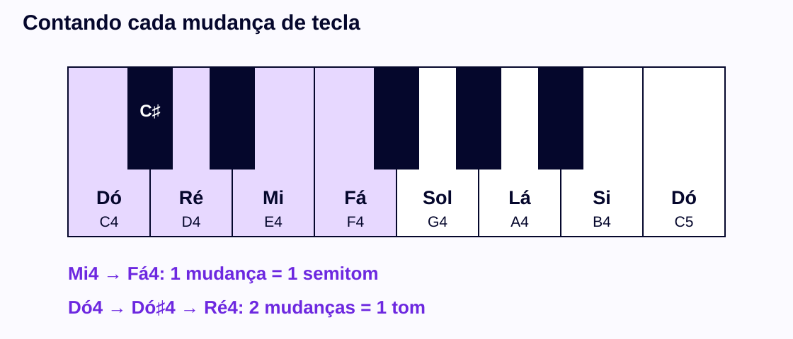
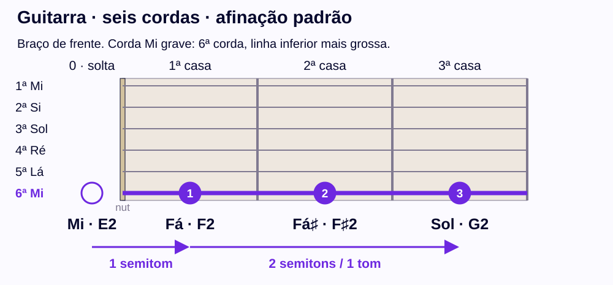
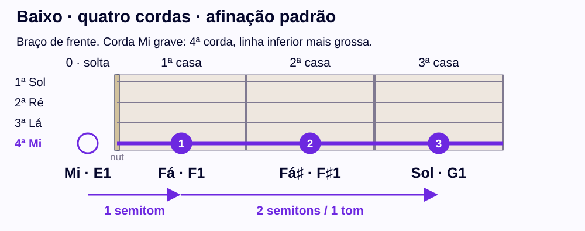
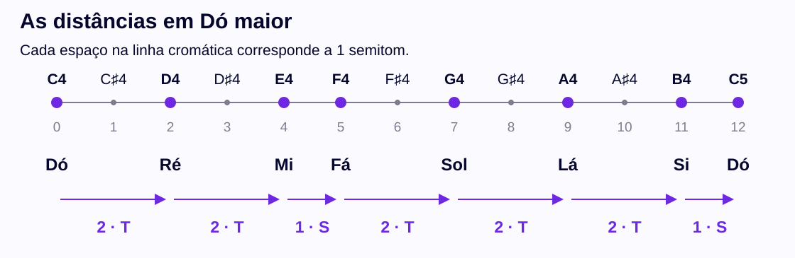
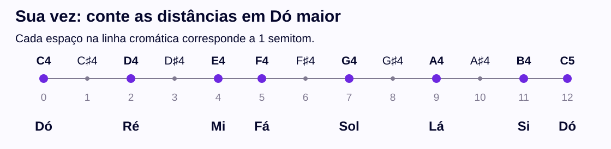

# Nem todo passo é igual: o padrão da escala maior

## Para que você vai usar isso?

Você quer improvisar, criar seus próprios solos e tocar uma música no tom de quem canta. Para isso, precisa saber quais notas cabem na música. A **escala maior** é o primeiro mapa, e ela nasce de passos de **tom** e **semitom**.

Contar esses passos também transforma uma orientação como **“suba um tom a partir de Fá”** em um movimento concreto no teclado ou no braço. Depois, ao estudar **transposição**, você poderá mudar a nota inicial preservando as distâncias de uma melodia. Os **intervalos** usados para estudar acordes e campo harmônico também dependem dessas distâncias.

**Hoje você vai contar um ou dois semitons e usar essa contagem no exemplo de Dó maior.** Não precisa improvisar ainda, construir acordes, transpor uma escala inteira nem reconhecer intervalos de ouvido. Todas as atividades têm uma forma de responder sem instrumento.

## Uma referência rápida para começar

Se precisar, consulte a [tabela de nomes e letras](lesson-a.pt-BR.md#um-mesmo-nome-pode-aparecer-de-duas-formas) e a [explicação dos números de oitava](lesson-a.pt-BR.md#o-nome-se-repete-a-altura-muda).

A referência essencial também está aqui: **Dó=C, Ré=D, Mi=E, Fá=F, Sol=G, Lá=A e Si=B**. Depois do Si, a sequência de nomes recomeça em Dó. Em C4 e C5, a letra é a mesma, mas o número indica outra oitava. Você consegue seguir a lição com essa referência, mesmo sem abrir o conteúdo anterior.

## A menor contagem que vamos usar

Nos exemplos desta lição, a oitava está dividida em **12 semitons iguais**. Um **semitom** é **meio tom**: um passo entre alturas vizinhas nesse sistema. Um **tom** corresponde a dois desses passos.

No teclado, siga para a **próxima tecla**, seja ela branca ou preta. Na mesma corda da guitarra ou do baixo, siga para a **próxima casa**. Cada um desses movimentos sobe um semitom nos exemplos mostrados.

O que contamos é a **mudança de uma posição para a seguinte**. O ponto de partida ainda não é um passo.

## Por que Mi–Fá e Dó–Ré têm distâncias diferentes?

Veja as teclas pretas e brancas na referência. Mi e Fá são teclas vizinhas. Já entre Dó e Ré há uma tecla preta.

**Mi4 até Fá4:** saia de Mi4 e vá à próxima tecla, Fá4. Foi **uma mudança**, portanto **um semitom**.

**Dó4 até Ré4:** saia de Dó4 e vá à próxima tecla, Dó♯4. Depois vá à próxima tecla, Ré4. Foram **duas mudanças**, portanto **dois semitons**, ou **um tom**.

A tecla entre Dó e Ré pode ser chamada de **Dó sustenido, C♯**, ou **Ré bemol, D♭**, neste sistema de afinação. O sustenido sobe um semitom em relação à nota nomeada; o bemol desce um semitom. Por isso, subir um semitom a partir de Dó e descer um semitom a partir de Ré chegam à mesma tecla do exemplo.

Não precisamos escolher entre essas duas grafias agora. Precisamos perceber que existe uma altura intermediária e incluí-la na contagem. Sustenidos e bemóis também podem nomear teclas brancas em outros contextos; a cor não define o símbolo.

### Sua vez: contando mudanças

Use a figura e responda antes de conferir a explicação. Se preferir, leia a sequência de nomes como uma lista de posições.

<!-- activity: b-ef -->
<fieldset class="practice" data-activity="b-ef"><legend>Quantos semitons há de Mi4 (E4) a Fá4 (F4)?</legend><label class="choice"><input type="radio" name="b-ef" value="a"/>Um semitom</label><label class="choice"><input type="radio" name="b-ef" value="b"/>Dois semitons, ou um tom</label><label class="choice"><input type="radio" name="b-ef" value="c"/>Nenhum semitom</label>

Uma dica

Observe se existe uma tecla entre Mi e Fá.

Conferir resposta

<strong>Resposta: Um semitom.</strong> É um semitom. Mi4 e Fá4 são teclas vizinhas; sair de uma e chegar à outra conta uma mudança.
<ul><li><strong>Se você escolheu “Dois semitons, ou um tom”:</strong> As duas posições mostradas correspondem a uma única mudança entre elas.</li><li><strong>Se você escolheu “Nenhum semitom”:</strong> Sem mudança de altura, a distância seria zero.</li></ul><h4>Pratique de novo</h4><fieldset class="practice" data-activity="b-ef-retry"><legend>Pratique de novo: de Si3 ao Dó4 seguinte, há quantos semitons?</legend><label class="choice"><input type="radio" name="b-ef-retry" value="a"/>Um semitom</label><label class="choice"><input type="radio" name="b-ef-retry" value="b"/>Dois semitons, ou um tom</label><label class="choice"><input type="radio" name="b-ef-retry" value="c"/>Nenhum semitom</label>

Uma dica

Si e o Dó seguinte são teclas vizinhas.

Conferir resposta

<strong>Resposta: Um semitom.</strong> Há um semitom, pois não existe tecla intermediária entre Si3 e C4.
<ul><li><strong>Se você escolheu “Dois semitons, ou um tom”:</strong> As duas posições mostradas correspondem a uma única mudança entre elas.</li><li><strong>Se você escolheu “Nenhum semitom”:</strong> Sem mudança de altura, a distância seria zero.</li></ul>

</fieldset>

</fieldset>
<!-- /activity -->

<!-- activity: b-cd -->
<fieldset class="practice" data-activity="b-cd"><legend>Quantos semitons há de Dó4 (C4) a Ré4 (D4)?</legend><label class="choice"><input type="radio" name="b-cd" value="a"/>Um semitom</label><label class="choice"><input type="radio" name="b-cd" value="b"/>Dois semitons, ou um tom</label><label class="choice"><input type="radio" name="b-cd" value="c"/>Nenhum semitom</label>

Uma dica

Siga Dó, Dó♯ e Ré. Conte as mudanças, começando em zero no Dó.

Conferir resposta

<strong>Resposta: Dois semitons, ou um tom.</strong> Há dois semitons, ou um tom: Dó até Dó♯ é o primeiro passo, e Dó♯ até Ré é o segundo.
<ul><li><strong>Se você escolheu “Um semitom”:</strong> Faltou contar a passagem pela posição intermediária.</li><li><strong>Se você escolheu “Nenhum semitom”:</strong> Sem mudança de altura, a distância seria zero.</li></ul><h4>Pratique de novo</h4><fieldset class="practice" data-activity="b-cd-retry"><legend>Pratique de novo: Sol4–Sol♯4–Lá4 mostra quantos semitons entre Sol4 e Lá4?</legend><label class="choice"><input type="radio" name="b-cd-retry" value="a"/>Um semitom</label><label class="choice"><input type="radio" name="b-cd-retry" value="b"/>Dois semitons, ou um tom</label><label class="choice"><input type="radio" name="b-cd-retry" value="c"/>Nenhum semitom</label>

Uma dica

O ponto de partida é Sol4. Conte cada passagem para o próximo nome da lista.

Conferir resposta

<strong>Resposta: Dois semitons, ou um tom.</strong> Há dois semitons. As três posições mostram duas mudanças, e não três.
<ul><li><strong>Se você escolheu “Um semitom”:</strong> Faltou contar a passagem pela posição intermediária.</li><li><strong>Se você escolheu “Nenhum semitom”:</strong> Sem mudança de altura, a distância seria zero.</li></ul>

</fieldset>

</fieldset>
<!-- /activity -->

## Um método que você pode repetir

1. Identifique a nota inicial e a nota de chegada.
2. Veja todas as teclas ou casas entre elas, incluindo as intermediárias.
3. Conte cada mudança de uma posição para a seguinte. Comece em zero na nota inicial.
4. Compare o resultado: um passo é um semitom; dois passos são um tom.

**Exemplo:** Dó recebe a contagem 0; Dó♯ recebe 1; Ré recebe 2. A distância de Dó a Ré é de dois semitons. Se você contou “três”, provavelmente contou as três posições exibidas, em vez das duas mudanças entre elas.

## A mesma contagem na corda Mi

Nos desenhos, a corda Mi grave tem o nome indicado e uma linha mais grossa. O círculo vazio está antes da pestana e representa a corda solta. Os outros pontos ficam dentro das casas. Cada marca é uma posição alternativa na mesma corda.

Na guitarra com afinação padrão, a sexta corda solta é **E2**. No baixo de quatro cordas com afinação padrão, a quarta corda solta é **E1**. Os nomes se repetem em registros diferentes.

| Posição na corda Mi | Nome | Guitarra | Baixo |
|---|---|---|---|
| Solta | Mi | E2 | E1 |
| Casa 1 | Fá | F2 | F1 |
| Casa 2 | Fá sustenido | F♯2 | F♯1 |
| Casa 3 | Sol | G2 | G1 |

**Mi até Fá:** solta → casa 1. Uma mudança: um semitom.

**Fá até Sol:** casa 1 → casa 2 → casa 3. Duas mudanças: dois semitons, ou um tom. A resposta à orientação do início da lição é **Sol**.

Essa regra de contar casas vale **na mesma corda**. Trocar de corda também muda a referência de afinação; não conte uma troca de corda como se fosse simplesmente avançar uma casa.

Você pode apontar as posições no desenho. Se já afina e toca o instrumento, também pode experimentar Fá–Fá♯–Sol devagar, na corda indicada, observando os dois deslocamentos. O número da casa indica a posição, não o dedo que você deve usar.

<!-- activity: b-transfer -->
<fieldset class="practice" data-activity="b-transfer"><legend>De Fá na casa 1 até Sol na casa 3, na mesma corda, qual é a distância nos dois instrumentos?</legend><label class="choice"><input type="radio" name="b-transfer" value="a"/>Um semitom</label><label class="choice"><input type="radio" name="b-transfer" value="b"/>Dois semitons, ou um tom</label><label class="choice"><input type="radio" name="b-transfer" value="c"/>Nenhum semitom</label>

Uma dica

Percorra casa 1, casa 2 e casa 3. A segunda casa também entra no caminho.

Conferir resposta

<strong>Resposta: Dois semitons, ou um tom.</strong> São dois semitons, ou um tom. Casa 1 até casa 2 é um passo; casa 2 até casa 3 é outro. A guitarra e o baixo estão em registros diferentes, mas o número de passos é o mesmo.
<ul><li><strong>Se você escolheu “Um semitom”:</strong> Faltou contar a passagem pela posição intermediária.</li><li><strong>Se você escolheu “Nenhum semitom”:</strong> Sem mudança de altura, a distância seria zero.</li></ul><h4>Pratique de novo</h4><fieldset class="practice" data-activity="b-transfer-retry"><legend>Pratique de novo: no baixo, da corda Mi solta (E1) até Fá na casa 1 (F1), qual é a distância?</legend><label class="choice"><input type="radio" name="b-transfer-retry" value="a"/>Um semitom</label><label class="choice"><input type="radio" name="b-transfer-retry" value="b"/>Dois semitons, ou um tom</label><label class="choice"><input type="radio" name="b-transfer-retry" value="c"/>Nenhum semitom</label>

Uma dica

A primeira casa é a próxima posição depois da corda solta.

Conferir resposta

<strong>Resposta: Um semitom.</strong> É um semitom: houve uma mudança, de solta para casa 1, sempre na mesma corda.
<ul><li><strong>Se você escolheu “Dois semitons, ou um tom”:</strong> As duas posições mostradas correspondem a uma única mudança entre elas.</li><li><strong>Se você escolheu “Nenhum semitom”:</strong> Sem mudança de altura, a distância seria zero.</li></ul>

</fieldset>

</fieldset>
<!-- /activity -->

## Dois pares importantes entre as notas naturais

**Mi–Fá** e **Si–Dó**, na passagem para a próxima oitava, têm um semitom. Não há uma tecla intermediária entre essas notas no teclado. Os outros pares consecutivos da sequência **Dó–Ré–Mi–Fá–Sol–Lá–Si–Dó** têm um tom.

Isso explica por que “passar para o próximo nome” nem sempre significa percorrer a mesma distância. Entre Sol e Lá, por exemplo, há Sol♯/Lá♭. Entre Si e o Dó seguinte, não há uma tecla intermediária.

<!-- activity: b-bc -->
<fieldset class="practice" data-activity="b-bc"><legend>De Si3 (B3) ao Dó4 (C4) seguinte, há um ou dois semitons?</legend><label class="choice"><input type="radio" name="b-bc" value="a"/>Um semitom</label><label class="choice"><input type="radio" name="b-bc" value="b"/>Dois semitons, ou um tom</label><label class="choice"><input type="radio" name="b-bc" value="c"/>Nenhum semitom</label>

Uma dica

Veja o fim de um ciclo de nomes e o início do seguinte; não há tecla entre essas duas.

Conferir resposta

<strong>Resposta: Um semitom.</strong> Há um semitom. O número da oitava muda de 3 para 4, mas esse par continua formado por teclas vizinhas.
<ul><li><strong>Se você escolheu “Dois semitons, ou um tom”:</strong> As duas posições mostradas correspondem a uma única mudança entre elas.</li><li><strong>Se você escolheu “Nenhum semitom”:</strong> Sem mudança de altura, a distância seria zero.</li></ul><h4>Pratique de novo</h4><fieldset class="practice" data-activity="b-bc-retry"><legend>Pratique de novo: de Mi4 a Fá4, sem tecla intermediária, qual é a distância?</legend><label class="choice"><input type="radio" name="b-bc-retry" value="a"/>Um semitom</label><label class="choice"><input type="radio" name="b-bc-retry" value="b"/>Dois semitons, ou um tom</label><label class="choice"><input type="radio" name="b-bc-retry" value="c"/>Nenhum semitom</label>

Uma dica

Conte somente a mudança de Mi para Fá.

Conferir resposta

<strong>Resposta: Um semitom.</strong> Há um semitom. Mi–Fá e Si–Dó são os dois pares consecutivos de nomes naturais com um semitom nesta sequência.
<ul><li><strong>Se você escolheu “Dois semitons, ou um tom”:</strong> As duas posições mostradas correspondem a uma única mudança entre elas.</li><li><strong>Se você escolheu “Nenhum semitom”:</strong> Sem mudança de altura, a distância seria zero.</li></ul>

</fieldset>

</fieldset>
<!-- /activity -->

## Aplicação: as distâncias em Dó maior

Vamos organizar a sequência **Dó–Ré–Mi–Fá–Sol–Lá–Si–Dó**. A linha abaixo mostra todas as posições intermediárias. Cada espaço horizontal representa um semitom, e os nomes naturais aparecem em suas posições.

| Par | Dó–Ré | Ré–Mi | Mi–Fá | Fá–Sol | Sol–Lá | Lá–Si | Si–Dó |
|---|---|---|---|---|---|---|---|
| Semitons | 2 | 2 | 1 | 2 | 2 | 2 | 1 |
| Nome da distância | Tom | Tom | Semitom | Tom | Tom | Tom | Semitom |

Essa sequência é a **escala de Dó maior**. Seu padrão de distâncias é **T–T–S–T–T–T–S**: T significa tom e S significa semitom. A contagem completa soma 12 semitons e chega ao Dó uma oitava acima.

Não precisamos transpor essa escala agora. Primeiro, vamos usar a referência para reconstruir suas distâncias. Você pode cobrir a tabela anterior e contar novamente na régua de prática.

<!-- activity: b-major-pattern -->
<fieldset class="practice" data-activity="b-major-pattern"><legend>Qual sequência descreve as distâncias de Dó–Ré–Mi–Fá–Sol–Lá–Si–Dó?</legend><label class="choice"><input type="radio" name="b-major-pattern" value="a"/>T–T–S–T–T–T–S</label><label class="choice"><input type="radio" name="b-major-pattern" value="b"/>T–T–T–S–T–T–S</label><label class="choice"><input type="radio" name="b-major-pattern" value="c"/>S–T–T–T–S–T–T</label>

Uma dica

Conte cada par na régua. Procure primeiro os dois pares sem posição intermediária.

Conferir resposta

<strong>Resposta: T–T–S–T–T–T–S.</strong> O padrão é T–T–S–T–T–T–S. Em semitons, 2+2+1+2+2+2+1=12, chegando ao Dó uma oitava acima.
<ul><li><strong>Se você escolheu “T–T–T–S–T–T–S”:</strong> Essa sequência troca as distâncias de Mi–Fá e Fá–Sol.</li><li><strong>Se você escolheu “S–T–T–T–S–T–T”:</strong> Dó–Ré tem dois semitons, e não um; confira também Sol–Lá.</li></ul><h4>Pratique de novo</h4><fieldset class="practice" data-activity="b-major-pattern-retry"><legend>Pratique de novo: no trecho Mi4–Fá4–Sol4, qual é a distância apenas de Mi4 até Fá4?</legend><label class="choice"><input type="radio" name="b-major-pattern-retry" value="a"/>Um semitom</label><label class="choice"><input type="radio" name="b-major-pattern-retry" value="b"/>Dois semitons, ou um tom</label><label class="choice"><input type="radio" name="b-major-pattern-retry" value="c"/>Nenhum semitom</label>

Uma dica

Considere apenas o primeiro par do trecho.

Conferir resposta

<strong>Resposta: Um semitom.</strong> Mi4 até Fá4 tem um semitom. O par seguinte, Fá4 até Sol4, tem dois; por isso a sequência desse trecho é S–T. Agora volte à régua de prática e reconte os sete pares, sem consultar a tabela de respostas.
<ul><li><strong>Se você escolheu “Dois semitons, ou um tom”:</strong> As duas posições mostradas correspondem a uma única mudança entre elas.</li><li><strong>Se você escolheu “Nenhum semitom”:</strong> Sem mudança de altura, a distância seria zero.</li></ul>

</fieldset>

</fieldset>
<!-- /activity -->

## Conferindo o resultado em uma frase

Leia **Dó–Ré–Mi–Fá** na referência. Os movimentos são um tom, um tom e um semitom. O último deslocamento é menor, embora todos avancem para o próximo nome da sequência.

Aponte cada nota e explique a distância até a seguinte. Se você conta cada mudança, inclui a tecla ou casa intermediária e distingue um de dois semitons, realizou o objetivo desta lição com apoio. Isso ainda não mede sua velocidade, sua execução ou sua capacidade de identificar essas distâncias apenas pelo som.

Lembra do objetivo do começo: improvisar e tocar no tom de quem canta? Você já vê o padrão que organiza a escala maior, T–T–S–T–T–T–S. É com esse mapa que, nas próximas lições, você vai montar escalas em outros tons e improvisar com elas.

Para continuar, escolha outro par na régua e refaça a contagem. Depois você poderá usar o mesmo raciocínio para estudar outras escalas, transpor pequenas melodias e compreender os intervalos que formam os acordes.

## Complementos opcionais

- [Steps and Accidentals, musictheory.net](https://www.musictheory.net/lessons/20): consulte a abertura sobre teclas vizinhas e dois passos. O recurso está em inglês e precisa de JavaScript. Se não abrir, os exemplos “Mi–Fá” e “Dó–Ré” desta lição já contêm a explicação essencial.
- [Construindo escalas maiores, Ableton Learning Music](https://learningmusic.ableton.com/pt/advanced-topics/building-major-scales.html): consulte a seção inicial, até o padrão de tons e semitons. O texto está em português. Use para explorar a mesma ideia depois da prática. Se o recurso não funcionar, a tabela e a régua de Dó maior acima bastam para esta atividade.
