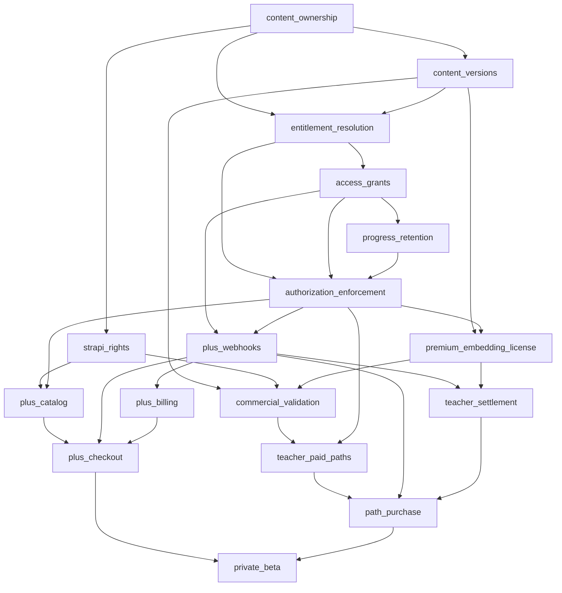

# MOT-115 — Feature flag registry and dependencies

**Status:** Proposed, revision `MOT-115-r2`. Prepared 2026-10-13, America/Fortaleza.
**Approval:** Pending PO review; no reviewed revision, approval date or named operational owners recorded.
**Issue:** [MOT-115](https://linear.app/motif-path/issue/MOT-115/m0-define-feature-flags-and-dependencies), under MOT-108.
**Inputs:** [MOT-114 architecture audit](MOT-114-architecture-audit.md), M1–M5 deliverable descriptions and the fixed MOT-108 decisions.
**Registry:** [MOT-115-feature-flags.json](MOT-115-feature-flags.json). This is a review artifact, not executable runtime configuration. Names become canonical only through explicit registry approval.

## Activation contract

Every flag defaults **OFF in every environment**, with empty cohort allowlists. Flags authorize activation of new commercial capabilities. They never erase data, substitute for access grants or switch off security checks on already protected resources.

For a new commercial action, the backend requires: approved M0 gates and relevant UX revision; environment configuration explicitly ON; approved subject cohort; all activation prerequisites ON for that action's applicable subject; valid domain authorization and policy. Production new actions also require `monetization.private_beta` admission. A missing, unknown or unavailable activation decision refuses the new action. Local/test/staging require explicitly configured sandbox cohorts and provider credentials; staging enablement never implicitly enables production.

The beta admission check is applied to new commercial actions after prerequisite evaluation. It is not a prerequisite edge on foundational flags, so the dependency graph remains acyclic. Buyer actions use buyer admission; paid publication/license acquisition use seller admission. An offer's seller must be approved for commercial rollout, but an existing buyer's purchased rights never depend on continued seller cohort membership.

Already-authorized callbacks, fulfillment, cancellations, reconciliation, refunds and settlement are evaluated against their durable obligation, verified integration identity and approved lifecycle policy, **not** current acquisition flags or cohort membership. Valid callback receipt continues even for an unknown transaction, but fulfillment waits for verified correlation rather than granting rights from the payload alone. Removing a cohort member never deletes their grants, purchases, progress or ledger entries.

Existing free learning and free teacher creation tools remain available. Disabling monetization must not cause paid resources to fall through to legacy free access. Unknown commercial ownership/access cannot be treated as free. If authoritative rights cannot be established, return the approved unavailable/denied state without destroying records; durable existing-grant delivery/recovery behavior must be specified in MOT-117.

## Registry and accountability

The JSON contains 17 flags, each with mapped runtime tickets, server evaluation authority, proposed accountable owner role, activation prerequisites, empty environment/cohort lists and safe OFF behavior. `named_owner` is deliberately unset; Gilson must assign an accountable person before rollout. Vue and Strapi are presentation/integration participants, never final evaluation authorities for protected operations.

| Flag suffix (`monetization.`) | Runtime deliverable | New capability |
|---|---|---|
| content_ownership | MOT-118 | Commercial ownership/provenance activation |
| content_versions | MOT-119 | Commercial immutable snapshots |
| strapi_rights | MOT-120 | CMS commercial metadata integration |
| commercial_validation | MOT-121 | Paid-content dependency validation |
| entitlement_resolution | MOT-122 | Central access resolution on new surfaces |
| access_grants | MOT-123 | New commercial grants |
| progress_retention | MOT-124 | Commercial continuity/recovery UX |
| authorization_enforcement | MOT-125 | Enforcement rollout on new surfaces |
| plus_catalog | MOT-127 | Plus sales catalog |
| plus_checkout | MOT-127, MOT-128 | New Plus checkout sessions |
| plus_webhooks | MOT-128 | New provider integration onboarding |
| plus_billing | MOT-129 | Billing lifecycle rollout |
| teacher_paid_paths | MOT-131 | New paid offers/publication |
| path_purchase | MOT-131 | New permanent path checkout sessions |
| premium_embedding_license | MOT-132 | New teacher commercial licenses |
| teacher_settlement | MOT-133 | New seller/settlement program onboarding |
| private_beta | MOT-137 | New commercial cohort admission |

These names preserve the ticket proposals. Potentially misleading names have explicit limits: progress retention itself is unconditional; existing-resource authorization itself cannot be disabled; established webhook receipt/processing cannot be disabled by `plus_webhooks`. OFF only stops new activation/onboarding or hides new UI. MOT-117 must encode these distinctions in contracts so the names cannot become destructive implementation shortcuts.

MOT-134 tests every runtime flag's commercial journey. MOT-135 tests every flag's targeting, dependencies and rollback. MOT-136 covers callbacks, grants, CMS sync, licenses, settlement and beta recovery. These validation deliverables map to flags they exercise; they do not introduce switches for turning off tests or observability. MOT-114/115/116/117/126/130 are approval/design gates rather than runtime flags; their mappings are in the JSON.

## Dependency graph

`requires_for_new_actions` is the authoritative edge list. Prerequisites point to dependents below. This is activation ordering, not an instruction to disable background obligation handling when a prerequisite turns OFF.

The proposed beta requires both Plus and teacher-commerce readiness, matching the combined MVP. MOT-117 may approve separate rollout tracks, but changing this dependency requires a new reviewed registry revision. Shared backend prerequisites may be enabled for service cohorts before user-facing commercial actions; server-owned prerequisite subject mappings must be explicit, particularly when a buyer depends on seller readiness. No current CMS or client-supplied flag can assert readiness.

## Server and UI evaluation

- Backend decisions use authenticated MotifPath UUIDs and trusted environment configuration. Cohort targeting is explicit allowlisting in r1; percentage rollout is deferred until a stable assignment/audit policy is approved.
- UI receives backend-resolved capability/denial information for the current caller and resource. Cached UI flags are hints; every protected mutation/read rechecks server authorization. CMS may hide editorial sales surfaces but cannot grant permission.
- New checkout authorization must durably correlate buyer, approved offer/amount/currency, content reference and provider session before provider handoff. A switch turned OFF between handoff and callback does not invalidate that existing obligation.
- Reuse server decision logic across catalog, direct lesson/exercise/practice reads, embeds, previews/exports and protected media. Commercial denial differs from learning prerequisites and language availability.
- Grant, progress, ledger and license records survive OFF and cohort changes. A valid permanent purchase remains independent of student Plus and teacher subscription status. Approved license/refund/withdrawal policies still apply; flags cannot invent their effects.
- OFF and evaluator outages prevent new risky actions; they do not erase durable records. The emergency control is an audited backend acquisition kill switch, mirrored in UI, not a bypass of enforcement or a command to stop callback workers.

Provider/flag technology and API response shapes remain decisions for MOT-117. The audited editorial AppConfig is not an existing flag control plane; there is no implied flag-service implementation in this document.

## Strapi unavailable or OFF

Strapi is not provisioned. Until provisioning and authenticated sync readiness pass, `strapi_rights` remains OFF and dependent new commercial actions are unavailable. Once integrated, preserve core-validated identifiers/revisions and authoritative rights through CMS outages. New publication or an offer requiring fresh editorial validation is blocked when readiness cannot be established. Existing purchases, subscription access, progress and financial callbacks must not depend on CMS availability.

Authenticated pending CMS notifications and reconciliation continue during rollback; core validates declarations and rejects stale/out-of-order escalation. Cached presentation may be used only under MOT-117's approved freshness/localization policy. Unpublishing or deleting a CMS document must not silently revoke purchased content. No cache TTL or license-expiry policy is invented here.

## Launch matrix

| Stage | Environment/cohort | Activation | Evidence required |
|---|---|---|---|
| Default | All environments, all users | All OFF, cohorts empty | Baseline free learning/authoring continues |
| Foundation rehearsal | Local/test, named sandbox service/user cohorts | Ownership → versions/CMS/resolver → grants → retention/enforcement | Approved contracts, backfill, protected-delivery and retained-rights tests |
| Provider rehearsal | Local/test/staging sandbox cohorts | Licenses/validation/catalog/callbacks → billing/settlement → checkout/paid paths/purchase | Verified sandbox receipt, durable idempotency, out-of-order replay, cancellation/refund/settlement cases |
| Staging beta | Staging approved buyer/seller cohorts | Dependencies ready, beta ON | MOT-134 journeys, MOT-135 OFF/in-flight drills, MOT-136 recovery/monitoring |
| Production dark | Production, no acquisition cohorts | Dependencies may be deployed; beta and acquisition flags OFF | Approved migrations/backfills and support/recovery capacity; deployed existing obligations serviced |
| Production private beta | Explicit production buyer/seller cohorts | Only approved actions and prerequisite cohorts ON, beta ON | MOT-137 launch decision, named owners, provider/CMS readiness, design revision and complete evidence |
| Rollback | Any environment/cohort | Beta/acquisition OFF first; onboarding/publication stopped | Existing rights, callbacks, billing support and obligations remain serviced |

Enabling an upstream flag does not automatically enable dependents. A prerequisite OFF suppresses dependent **new actions**, even if their own configured value remains ON. Recovery does not auto-expand cohort lists or resurrect intentionally disabled acquisitions.

## Audited rollback and recovery procedure

1. Record operator, time, reason/incident, environment, prior/new configuration revisions, flags/cohorts affected and expected preserved obligations. Named accountable owners and authorized operator roles are required before launch.
2. Set beta admission, Plus checkout, path purchase and new paid publication/license/seller onboarding OFF server-side; mirror disabled acquisition surfaces in UI. Invalidate stale capability caches under the approved propagation contract. Direct API requests must observe the new decision before initiating a new checkout.
3. Keep verified provider receipt, fulfillment, subscription cancellation/status, refunds/chargebacks, reconciliation and existing settlement obligations operating. Preserve protected-resource enforcement and existing grant delivery. Do not roll back to a binary incapable of recognizing commercial resources or servicing stored obligations.
4. Inspect pending provider sessions/events, unfulfilled receipts, entitlement updates, CMS sync and settlement jobs. Correlate and replay idempotently; quarantine unverified/uncorrelated inputs rather than issuing grants. Confirm permanent purchase access and retained progress for users removed from cohorts.
5. Record validation evidence for existing-right delivery, free authoring, unchanged purchase/progress/ledger records and callback backlog recovery. Rollback safety must use real persistence and provider sandbox tests in MOT-135/136; no passing result is claimed here.
6. Re-enable only after incident resolution and an explicit reviewed configuration revision, checking prerequisites and cohorts in topological order. Preserve the audit history; do not silently restore acquisition state.

MOT-117 must approve decision propagation/cache bounds and transaction race semantics before implementation. A callback after OFF from a previously authorized checkout is valid input; a new checkout created after OFF is refused. Ledger/grant transitions follow approved financial rules, never flag state alone.

## Mandatory commercial traceability and idempotency

Revision r2 records Gilson's requirement on 2026-10-13. These controls apply even when acquisition flags are OFF; neither auditability nor duplicate protection has an opt-out flag.

Every operation with direct or indirect financial consequences must have a durable, attributable audit trail. Scope includes checkout, charges, purchase fulfillment, grants, subscription changes, refunds, chargebacks, commissions, settlement and reconciliation; also free-to-paid/paid-to-free changes, prices/offers, ownership/provenance, publishing/withdrawal, commercial content/version changes, embedding licenses, CMS synchronization, commercial flags/cohorts and administrative overrides. Operational application logs alone are insufficient.

Each audit record identifies the operation and attempt, authenticated actor or service, environment, time, action, resource and reviewed policy/configuration revision, reason, before/after commercial state, outcome and relevant transaction/provider references. Correlation and causation identifiers must connect a source change through asynchronous work to its resulting financial or entitlement effects. Failed, denied, duplicate and uncertain attempts remain traceable as attempts; they must not produce duplicate financial effects. Financial corrections append compensating records rather than overwriting history. Records must be protected against alteration/deletion; MOT-117 defines access, retention, sensitive-data minimization and tamper-evidence requirements. Do not log credentials or raw payment secrets.

A committed commercial state change and its audit evidence must be durably coupled; audit failure cannot silently leave an untraceable change. A request with an uncertain provider outcome must retain its pending operation and reconcile it before retrying a charge. Distributed steps require durable correlation and recovery; this requirement does not assume one database transaction can cover an external provider.

One logical operation may be delivered repeatedly but must produce its intended business effects only once. MOT-117 defines durable idempotency keys scoped by environment, actor/integration, action and business operation, with a request fingerprint. The same key and same request return the existing result/status; the same key with different intent is rejected. Concurrent retries, restarts and delayed replays must not duplicate a charge, receipt, grant, refund or settlement. A timeout is not evidence that the first operation failed.

Provider event deduplication alone is insufficient: distinct event IDs can refer to the same business transaction. Both transport-event deduplication and business-transition uniqueness are required, with out-of-order handling. Propagate the logical operation identity through jobs, callbacks, CMS notifications and reconciliation; use provider idempotency where supported and approved recovery semantics where it is not. Deduplication retention must cover approved replay/financial lifecycle requirements, not rely solely on an in-memory cache or arbitrary short TTL.

For example, changing a path from free to paid records the actor, path/version, prior/new commercial state, offer reference, reason and operation identity. Retrying that same change adds a traceable duplicate attempt but creates no second transition or downstream effect. A later intentional price change is a new operation, even if its payload resembles an earlier one. Existing learner/purchaser treatment is governed by approved MOT-117 policy; the change itself never invents revocation rules.

Required behavior scenarios before implementation: sequential and concurrent duplicate requests; same key with conflicting input; restart after a committed effect but before reply; duplicate/distinct provider events for one transaction; out-of-order delivery; uncertain provider outcome; CMS/admin free-to-paid retries; audit persistence failure; end-to-end causal reconstruction; replay while acquisition flags are OFF. Verify these against real persistence and provider sandbox/recovery fixtures in MOT-125/128/133/134/135/136, following TDD. This draft specifies requirements; it does not claim those tests exist or pass.

## Acceptance and approval record

| MOT-115 criterion | Draft evidence |
|---|---|
| Every M1–M5 runtime subtask covered | JSON flags and validation deliverable mappings; planning/design gates listed separately |
| All defaults OFF | Per-flag false defaults and empty cohorts in every environment |
| Acyclic dependency graph | JSON edge list; topological validation performed on this revision |
| OFF preserves rights/progress and authorized events | Activation contract, per-flag OFF rules and rollback steps |
| Reviewable launch/rollback | Environment/cohort matrix and audited recovery procedure |

Approval remains pending. Before marking MOT-115 approved: Gilson records approval of `MOT-115-r2` (or a revised version), date and scope; named owners are assigned; unresolved targeting/propagation details are resolved in MOT-117 contracts. MOT-114 evidence review, MOT-116 commercial Figma approval and MOT-117 approved contracts remain M0 gates. Preparing this registry does not approve financial policy, create flags in production or unblock monetization code.

## Behavior specifications

Proposed, unimplemented scenarios are in [commercial controls](../features/monetization/commercial-controls.feature). They describe agreed rollout, retained-rights, traceability and idempotency requirements; their presence is not evidence of approval or passing runtime tests.

## Epic delivery workflow

Per Gilson's instruction on 2026-10-13, monetization task branches start from `feat/MOT-107/monetization-mvp` and target that epic integration branch. The epic is merged into the repository's base only when a deliverable version is ready and approved: `main` for motifpath-specs; use the applicable repository's integration base for implementation repositories. MOT-115 work is on `featu/MOT-107/monetization-mvp/MOT-115/commercial-rollout-controls`. Task integration does not constitute product/design approval or permission to implement before M0 gates pass.

